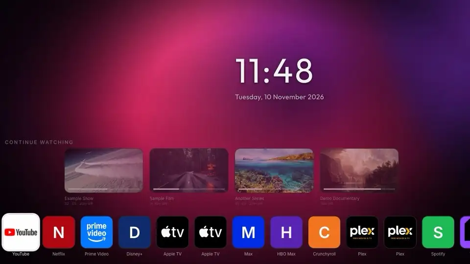
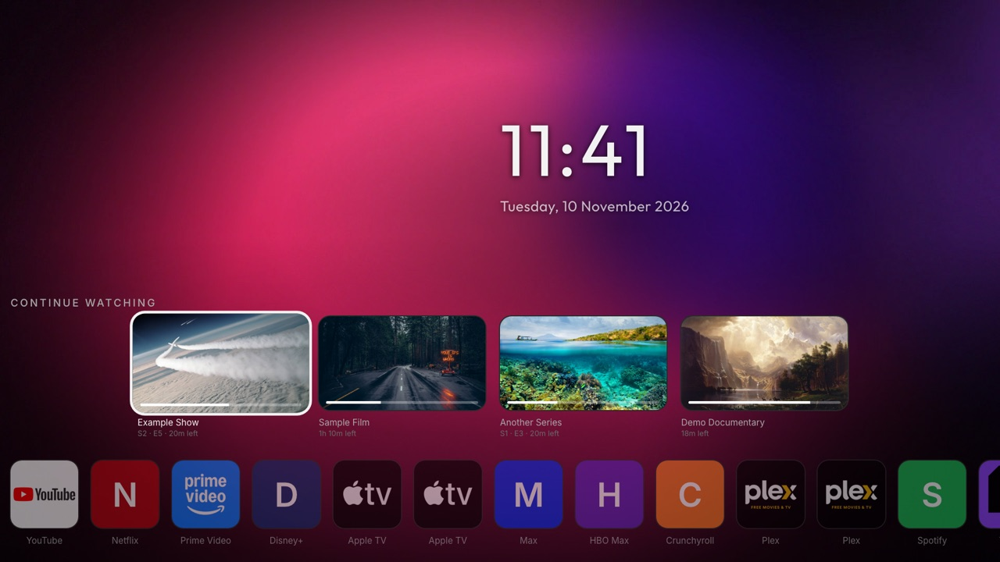
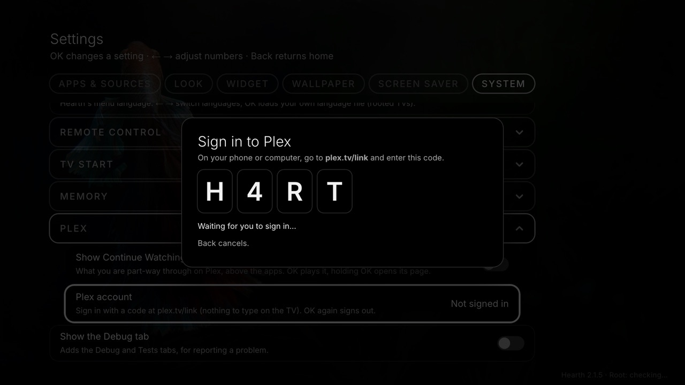
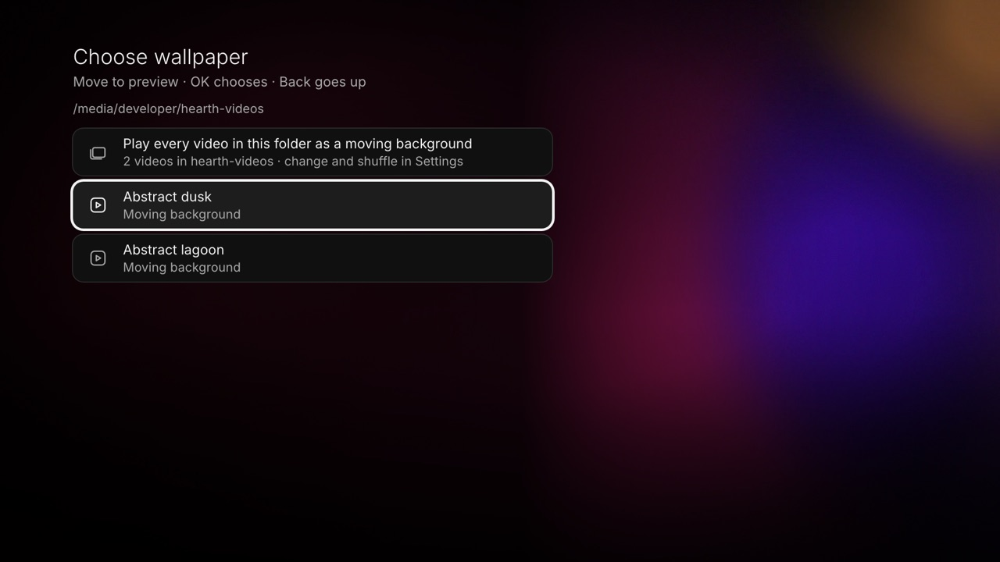
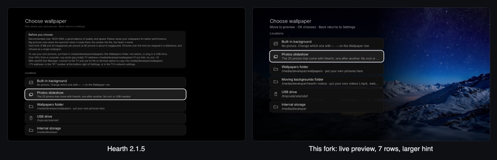
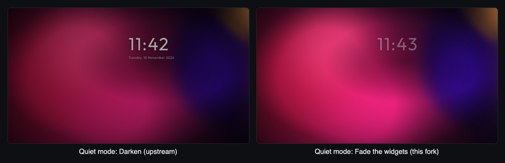
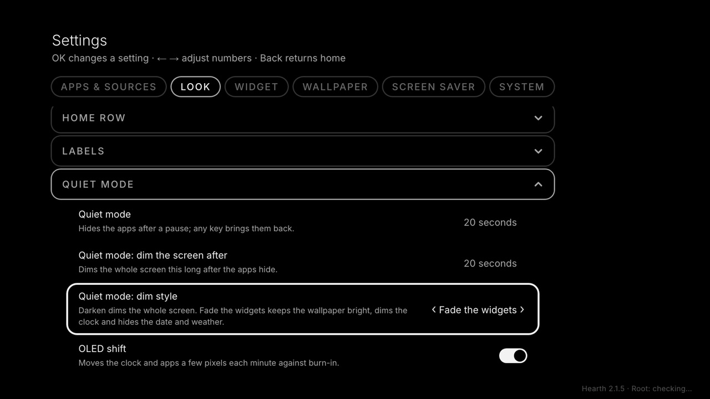

<p align="center"></p>

# Hearth (fork)

A personal fork of **[Hearth for WebOS](https://github.com/rudra-avatar/Hearth)** by rudra-avatar, the fast, calm home screen for LG webOS TVs.

For what Hearth is, how to install it and how every setting works, read the [upstream README](https://github.com/rudra-avatar/Hearth#readme) and the [Hearth guides](https://rudra-avatar.github.io/Hearth/). This page covers only what this fork adds or changes.

**Base:** Hearth **2.1.5** plus 4 commits. Built and used daily on an LG webOS 4.5 TV (Chrome 53), rooted with the Homebrew Channel.



## What this fork adds

### Continue Watching from Plex

A row of what you are part-way through on Plex, shown above the apps.



- Turn it on in *Settings, System, Plex: Show Continue Watching*.
- Sign in with *Plex account*: the TV shows a code to enter at plex.tv/link on your phone or computer, so there is nothing to type with the remote. OK on *Plex account* again signs out.
- Up from the top row reaches it and Down goes back. OK plays the item; holding OK opens its page.
- Items open in [Plex Lite](https://github.com/Obednal97/plex-lite) when it is installed, otherwise in the official Plex app.
- The saved list shows at once and the server is read a few seconds later. If the server's address changes, it is found again through plex.tv. If the sign-in is revoked, the row goes and Settings says *Not signed in*.
- Works without root.



This was offered upstream as [#17](https://github.com/rudra-avatar/Hearth/pull/17) and declined (bundle size, network use and keeping a token), so it lives here.

### Moving backgrounds (video wallpapers)

Use looping videos as the home screen background.

- *Settings, Wallpaper* has a **Moving backgrounds folder** (`/media/developer/hearth-videos` on the TV), and any folder you browse lists its `.mp4`, `.webm` and `.mov` files. Pick one video, or *Play every video in this folder*.
- A picture with the same name as a video (`.jpg`, `.jpeg` or `.png`) is its poster: shown while the video starts, and again if it fails or stalls.
- *Change video*: never, each time you come Home after 5 minutes away, or every 10, 30 or 60 minutes. *Shuffle* works as for slideshows.
- *Shade for moving backgrounds* (on by default) adds a soft glow behind the clock and a deeper fade behind the apps so text stays readable.
- Only one video element exists, and only while Hearth is on screen, so the decoder is free for other apps. On a webOS 4.5 TV the whole TV sits at about 9% CPU with a video playing behind Home.
- Loops must be seamless in the file itself.



### Live-preview wallpaper picker

- Moving the highlight shows that choice behind the list. Nothing is saved until you press OK, so opening the picker and pressing Back changes nothing.
- 7 rows instead of 9, so the list fits a 1080p screen, on a dark panel with Settings hidden while you pick.
- Upstream's advice box is replaced by a one-line hint: *Move to preview, OK chooses, Back returns*.



### Quiet mode: "Fade the widgets"

A second dim style for quiet mode (*Settings, Look, Quiet mode: dim style*):

- **Darken** (upstream's, the default) dims the whole screen.
- **Fade the widgets** keeps the wallpaper or video bright, dims the clock to 35% and fades the date and weather out. Any key or pointer move brings them back.





It uses quiet mode's own timer and wake, so nothing else runs in the background. *Quiet mode* and *Quiet mode: dim the screen after* also go up to 120 seconds here (upstream: 60).

## Changed defaults

| | Upstream 2.1.5 | This fork |
| --- | --- | --- |
| Screen saver | On (rooted TVs) | Off. An explicit On is kept |
| Check for updates | Shown | Hidden: it would install the plain upstream release over this build. Update by building this fork |
| Option descriptions | 20 px | 22 px |
| Line under each Settings and picker title | 19 px, muted | 26 px, easier to read from the sofa |

Everything else behaves exactly as upstream. The fork's new text is English only; in other languages those rows fall back to English.

## Build and install

Same as upstream:

```sh
npm install
npm run build        # dist/: app.js for Chrome 53+, app.legacy.js for webOS 3.x
npm run package      # build/tld.my.customlauncher_<version>_all.ipk
npm run test:local   # this fork's tests (Plex, moving backgrounds, settings)
npm test             # upstream's tests
```

Install the ipk as the upstream README describes. It uses the same app ID as Hearth, so it installs over an existing Hearth and keeps your settings.

## How the fork is kept

The fork is a few commits on top of an upstream release tag, rebased onto each new release. To keep that cheap:

- Our code sits in our own files (`src/config/local.ts`, `src/lib/plex.ts`, `src/lib/videowall.ts`, `src/hooks/useContinueWatching.ts`, `src/components/VideoWallpaper.tsx` and others), with one-line hooks into upstream files.
- Upstream code we don't use is switched off by a condition, not deleted (for example `UPDATES_ENABLED` in `src/config/local.ts`).
- Our strings sit in one `local build` block at the end of `src/i18n/en.ts`, and our CSS in one section at the end of `src/theme/global.css`.
- Our tests run from `test:local`; upstream's `test` line is untouched.
- This page and its screenshots live in `.github/`, which GitHub shows in place of the root README, so upstream's `README.md` stays as it is.
- The screenshots come from this build in a desktop browser at 1920x1080, with demo data: made-up titles, Hearth's bundled public-domain photos as card art, and our own generated abstract loops as the moving backgrounds.

## Contributed upstream

Work that started in this fork and is now part of Hearth:

| PR | What |
| --- | --- |
| [#16](https://github.com/rudra-avatar/Hearth/pull/16) | Input status: unplugged inputs greyed out, HDMI-CEC device names |
| [#18](https://github.com/rudra-avatar/Hearth/pull/18) | Set Hearth as the TV's Home app (webOS 4.x) |
| [#19](https://github.com/rudra-avatar/Hearth/pull/19), [#22](https://github.com/rudra-avatar/Hearth/pull/22) | Reassign remote buttons, with a picture of your remote |
| [#20](https://github.com/rudra-avatar/Hearth/pull/20) | "When Home is pressed": the first app or the last app opened |
| [#21](https://github.com/rudra-avatar/Hearth/pull/21) | App icons: notice an icon that changed at the same path |
| [#25](https://github.com/rudra-avatar/Hearth/pull/25) | "When the TV turns on, open…" |
| [#29](https://github.com/rudra-avatar/Hearth/pull/29), [#30](https://github.com/rudra-avatar/Hearth/pull/30) | Recent apps: custom names and icons, instant opening |
| [#31](https://github.com/rudra-avatar/Hearth/pull/31) | The LG Content Store on the home row |
| [#46](https://github.com/rudra-avatar/Hearth/pull/46) | The pointer wake for quiet mode (2.1.4) |

#25 was merged; the maintainer brought the others into 2.0 and 2.1.4 by hand.

## Licence and credits

MIT, as upstream (see [LICENSE](../LICENSE)). Hearth is the work of rudra-avatar and its contributors; see the credits in the [upstream README](https://github.com/rudra-avatar/Hearth#credits).
